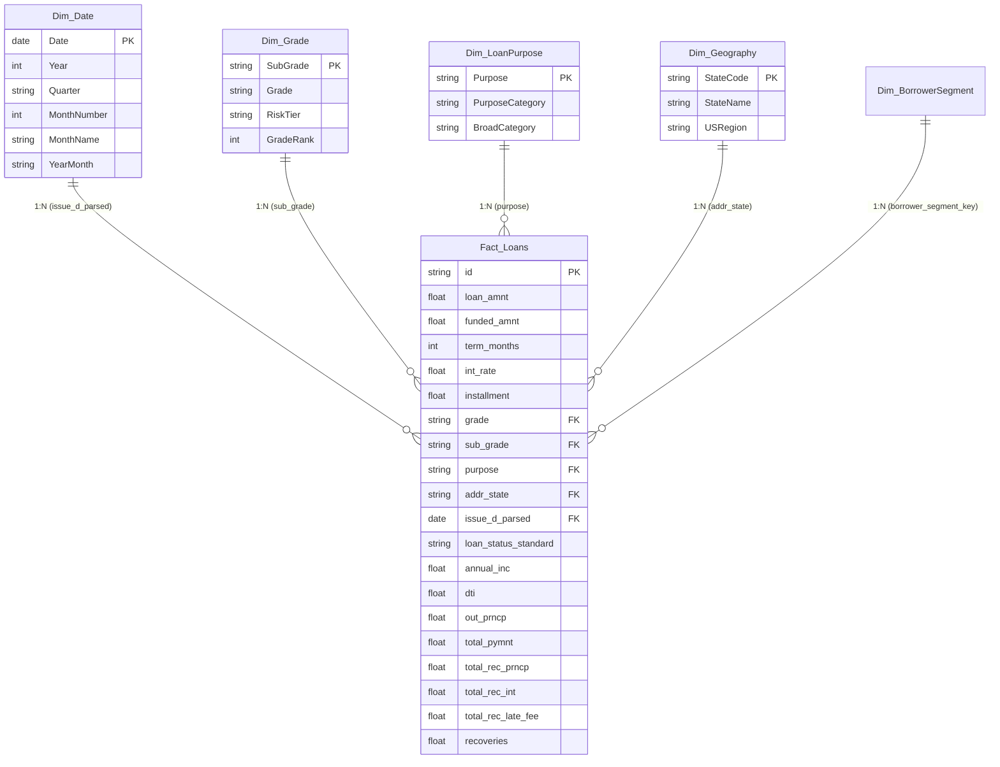

# Power BI Analytical Data Model Architecture
## LendingClub Credit Risk & Loan Portfolio Star Schema

This document details the enterprise star-schema data model engineered for the **Loan Portfolio & Credit Risk Analysis** Power BI solution. The dimensional model adheres to Kimball modeling methodologies, ensuring optimal query performance, DAX simplicity, and scalable cross-filtering.

---

## 1. Dimensional Architecture Overview

---

## 2. Table Specifications & Cardinality

### Fact Table: `Fact_Loans`
- **Granularity:** One record per individual loan origination.
- **Keys:**
  - `id` (Primary Key, unique loan account)
  - `issue_d_parsed` (Foreign Key -> `Dim_Date[Date]`)
  - `sub_grade` (Foreign Key -> `Dim_Grade[SubGrade]`)
  - `purpose` (Foreign Key -> `Dim_LoanPurpose[Purpose]`)
  - `addr_state` (Foreign Key -> `Dim_Geography[StateCode]`)
- **Key Numeric Measures:**
  - `loan_amnt`, `funded_amnt`, `int_rate`, `installment`, `annual_inc`, `dti`
  - `out_prncp`, `total_pymnt`, `total_rec_prncp`, `total_rec_int`, `total_rec_late_fee`, `recoveries`
- **Status & Risk Attributes:**
  - `loan_status_standard`, `term_months`, `is_bad_loan`, `is_delinquent`

---

### Dimension Table: `Dim_Date`
- **Granularity:** One record per calendar day spanning platform activity (2007-01-01 through 2018-12-31).
- **Attributes:**
  - `Date` (Key, e.g., 2015-12-01)
  - `Year` (Integer, e.g., 2015)
  - `Quarter` (String, e.g., "Q4")
  - `MonthNumber` (1 to 12)
  - `MonthName` ("January" ... "December")
  - `YearMonth` ("2015-12")
  - `FiscalYear` ("FY2015")

---

### Dimension Table: `Dim_Grade`
- **Granularity:** One record per credit subgrade (35 subgrades: A1 through G5).
- **Attributes:**
  - `SubGrade` (Primary Key, e.g., "A1", "B3", "E2")
  - `Grade` (e.g., "A", "B", "C", "D", "E", "F", "G")
  - `RiskTier` ("Prime", "Near Prime", "Subprime", "High Risk")
  - `GradeRank` (1 to 35 for deterministic visual sorting)

---

### Dimension Table: `Dim_LoanPurpose`
- **Granularity:** One record per unique loan purpose category.
- **Attributes:**
  - `Purpose` (Primary Key, e.g., "debt_consolidation", "credit_card", "home_improvement")
  - `PurposeName` (Clean display label, e.g., "Debt Consolidation", "Credit Card Refinance")
  - `BroadCategory` ("Refinancing & Debt Relief", "Personal & Lifestyle", "Business & Investment", "Real Estate")

---

### Dimension Table: `Dim_Geography`
- **Granularity:** One record per US State / Territory.
- **Attributes:**
  - `StateCode` (Primary Key, 2-letter ISO, e.g., "CA", "NY", "TX")
  - `StateName` ("California", "New York", "Texas")
  - `USRegion` ("West", "Northeast", "South", "Midwest")

---

## 3. Relationships & Filter Flow Rules

| From Table | From Column | To Table | To Column | Cardinality | Cross Filter Direction | Security Filtering |
| :--- | :--- | :--- | :--- | :--- | :--- | :--- |
| `Fact_Loans` | `issue_d_parsed` | `Dim_Date` | `Date` | Many to One (`*:1`) | Single (`Dim_Date` filters `Fact_Loans`) | None |
| `Fact_Loans` | `sub_grade` | `Dim_Grade` | `SubGrade` | Many to One (`*:1`) | Single (`Dim_Grade` filters `Fact_Loans`) | None |
| `Fact_Loans` | `purpose` | `Dim_LoanPurpose` | `Purpose` | Many to One (`*:1`) | Single (`Dim_LoanPurpose` filters `Fact_Loans`) | None |
| `Fact_Loans` | `addr_state` | `Dim_Geography` | `StateCode` | Many to One (`*:1`) | Single (`Dim_Geography` filters `Fact_Loans`) | None |

### Performance Optimization Directives:
1. **Single-Direction Filtering:** Bi-directional relationships are strictly avoided to eliminate ambiguity and performance degradation.
2. **Hidden Keys:** Foreign key columns in `Fact_Loans` are hidden from report view; end-users slice exclusively via dimensions.
3. **Sort By Columns:** `MonthName` sorted by `MonthNumber`, `SubGrade` sorted by `GradeRank`.
